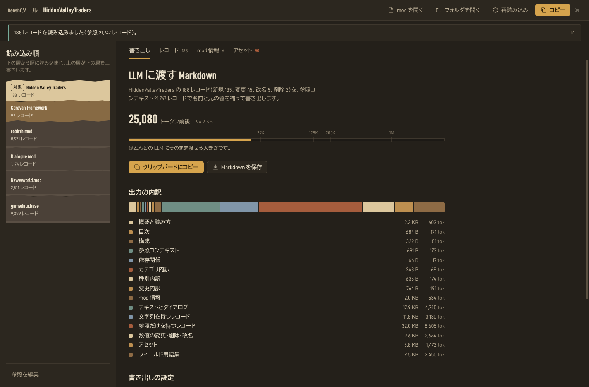
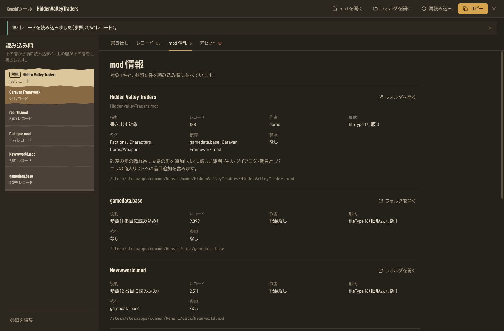

# kongyo-kenshi-tool

[](https://github.com/kongyo2/kongyo-kenshi-tool/actions/workflows/ci.yml)
[](https://github.com/kongyo2/kongyo-kenshi-tool/releases/latest)
[](LICENSE)
[](https://github.com/kongyo2/kongyo-kenshi-tool/releases/latest)
[](https://deepwiki.com/kongyo2/kongyo-kenshi-tool)


Kenshi の `.mod` を解析し、LLM に渡しやすい Markdown に変換する Electron + React 製デスクトップツールです。

## スクリーンショット

デモ用に作ったサンプルの mod データを読み込んだ画面です。





## 主な機能

- `.mod` / `.base` ファイル、mod フォルダの読み込み（選択ダイアログ・ドラッグ&ドロップ対応）。`locale` の `.translation` もファイル指定で読み込めます
- **読み込み順の地層表示**: バニラ → 参照 mod → 対象 mod の順に重ねて表示し、参照の追加・並べ替え・解除ができます
  - Steam ライブラリからバニラの `data` フォルダを自動検出
  - `data/mods.cfg`（ゲームで有効な mod と読み込み順）から参照をまとめて追加
- **LLM 向け Markdown の書き出し / クリップボードへのコピー**
  - 推定トークン数と、128K / 200K / 1M コンテキストに収まるかの目安、章ごとの大きさを表示
  - 追加・変更・改名・削除（FCS の `REMOVED` フラグ）を区別し、変更レコードには参照コンテキスト上の「元の値」を併記
  - 削除された参照（v0〜v2 がすべて 2147483647）・削除された配置インスタンスを明示
  - ダイアログは パッケージ → ダイアログ → 行 → 返答 の木として、共有される行は 1 回だけ展開
  - 条件・効果を読める式で表示（真偽値/数値/タグ条件の判定仕様、`==` と `>` が「以上」になる条件、repetition limit の実時間、名前に `Unfinished` を含むダイアログの無効化、行の選択スコアの推定）
  - ワードスワップ（`/BROTHER/` など）の展開候補、参照しているアセットファイルの所在（mod フォルダ / ゲーム本体 / 欠落）
  - 出力に現れたフィールドの FCS 定義（型・既定値・説明）をまとめた用語集
- **レコード一覧**: 名前・stringId・文字列で検索、変更の種類・カテゴリ・mod で絞り込み、フィールド名にカーソルを合わせると FCS の説明を表示
- **mod 情報**: ヘッダ、Workshop の `.info`（タイトル・ID・タグ）、依存関係、解析時の警告、読み込めなかったファイル
- **アセット**: メッシュ・テクスチャ・物理データなどのファイル参照と、その所在の確認

## 解析の根拠

- バイナリ形式は [OpenConstructionSet](https://github.com/lmaydev/OpenConstructionSet) の `OcsReader` / `ContextBuilder` に準拠し、実際のゲームデータと Workshop の mod で検証しています（変更種別 3 = 改名、fileType 16 の saveData 上位ビット、削除フラグ `REMOVED` など）
- フィールドの型・既定値・説明と列挙値は、Steam Workshop の「Customized fcs def (This is not a mod)」(2909495250) v1.0.68 の `fcs.def` / `fcs_enums.def` から生成して組み込んでいます（`src/shared/fcs-data.generated.ts`）
- ダイアログ条件・効果・イベントの仕様は、Steam ガイド「MODガイド ダイアログの条件、効果、イベントの一覧」の検証結果に基づいています

## 動作環境

- Windows（配布物は Windows 用ポータブル実行ファイル）
- 開発時は Node.js `>=22.18.0`（テストは Node の TypeScript 実行機能を使います）

## 使い方

1. アプリを起動する。
2. 左の「読み込み順」でバニラや前提 mod を参照に加える（任意）。参照があると、名前の解決と変更前の値の比較ができます。
3. 「mod を開く」「フォルダを開く」、またはウィンドウへのドラッグ&ドロップで `.mod` を読み込む。
4. 「書き出し」画面で大きさと内訳を確認し、「クリップボードにコピー」または「Markdown を保存」。

## 開発

```bash
npm install
npm run dev          # Vite + Electron の開発起動
npm run typecheck    # TypeScript の型チェック
npm run format       # oxfmt で整形チェック (format:fix で整形)
npm run lint         # oxlint (--deny-warnings)。lint:pretty は人向けの表示
npm test             # node --test によるパーサのテスト
npm run check        # typecheck + format + lint + test + build
```

手元のゲームデータでパーサを検証する:

```bash
npm run verify:corpus -- "D:/steam/steamapps/common/Kenshi/data" "D:/steam/steamapps/workshop/content/233860"
```

FCS 定義を更新したときは、組み込みデータを再生成します:

```bash
node scripts/generate-fcs-data.ts "<fcs.def があるフォルダ>" "<出典の説明>"
```

## ビルド

Windows 用ポータブル実行ファイルを生成します。

```bash
npm run dist
```

成果物は `release/` 以下に出力されます。

## ディレクトリ構成

- `electron/` — メインプロセス（読み込み・書き出し・設定）、preload、Kenshi 環境の検出
- `src/` — React レンダラ
  - `views/` — 書き出し / レコード / mod 情報 / アセット の各画面
  - `components/` — 読み込み順の地層表示などの UI 部品
  - `lib/` — 集計などのロジック
  - `shared/` — メイン・レンダラ間で共有する型、mod 解析、レコード合成、FCS 定義、Markdown 生成
- `scripts/` — 実データ検証と FCS 定義データの生成
- `test/` — パーサのテスト（テスト用 mod バイナリはその場で生成）
- `docs/screenshots/` — README 用スクリーンショット

## ライセンス

[MIT License](LICENSE)
